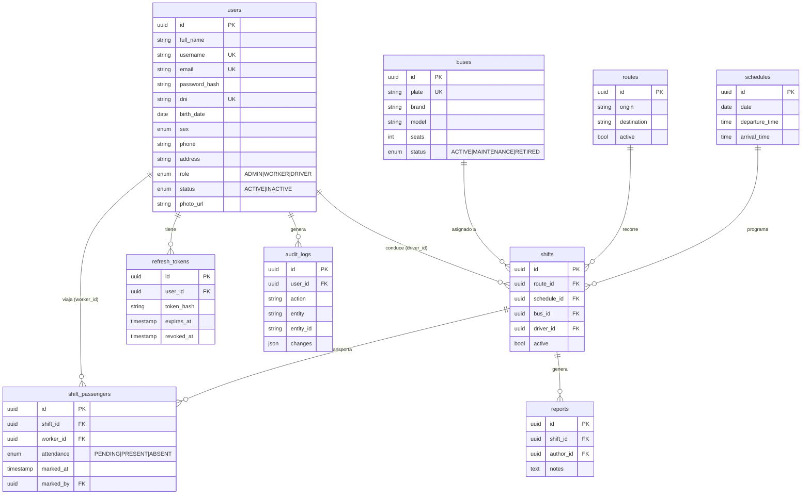

# Modelo de datos (borrador)

Convenciones: tablas en `snake_case` plural, claves UUID, `created_at`/`updated_at` en todas, borrado lógico donde aplique, FKs con índices.

## Reglas de integridad

- `shift_passengers`: único `(shift_id, worker_id)`; el conteo no puede superar `buses.seats`.
- `shifts.driver_id` debe apuntar a un usuario con rol DRIVER; `shift_passengers.worker_id` a un WORKER (validado en el servicio).
- Un bus o chofer no puede estar en dos turnos con horarios solapados (validado en el servicio; evaluar restricción de exclusión en PostgreSQL).
- Las tablas puente `Turno_Ruta`, `Turno_Horario` y `Turno_Bus` del legado se eliminan: eran redundantes.
- `users.birth_date` reemplaza al campo `Edad` (la edad se calcula).

## Mapeo desde el legado

| Legado                    | Nuevo                              |
| ------------------------- | ---------------------------------- |
| Cargo (1/2/3)             | `users.role` (ADMIN/WORKER/DRIVER) |
| Usuario                   | users                              |
| Bus, Ruta, Horario, Turno | buses, routes, schedules, shifts   |
| Asistencia                | shift_passengers.attendance        |
| Reporte                   | reports                            |
